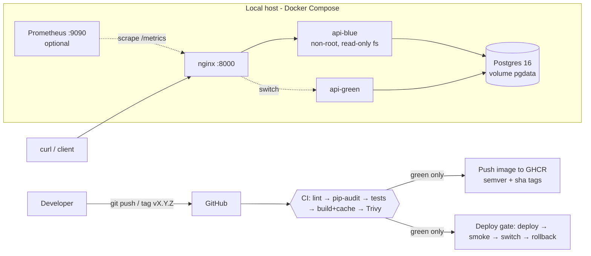

# Apex Operations API — 48-hour DevOps assessment

A small FastAPI incident-tracking service (synthetic data only) packaged in Docker and run locally with Docker Compose + PostgreSQL + nginx. Includes CI, versioned releases, blue/green deploys, rollback, observability and a runbook.

## Architecture


## Project layout
```
apex-ops/
├── app/                  main.py (API), db.py (models/engine)
├── tests/                conftest.py, test_api.py (13 tests, 1 intentional-failure demo)
├── Dockerfile            multi-stage, pinned base, non-root UID 10001
├── docker-compose.yml    db + api-blue/api-green + nginx (+ prometheus profile)
├── nginx/                default.conf (+ .template used by scripts)
├── monitoring/           prometheus.yml, alerts.yml
├── scripts/              deploy.sh, rollback.sh, failure_demo.sh, lib.sh
├── .github/workflows/    ci.yml
├── docs/                 RUNBOOK, RELEASE, MONITORING, FAILURE_INVESTIGATION, SECURITY, AWS_PATH, DECISION_MEMO, AI_DISCLOSURE
├── .env.example  Makefile  requirements*.txt  ruff.toml  pytest.ini
└── evidence/             logs/screenshots you capture
```

## Prerequisites
Docker Desktop (or Docker Engine) with Compose v2, `curl`, `bash`. Python 3.12 only if you run tests outside Docker. No cloud account needed.

## Run locally (exact steps)
1. `cp .env.example .env` and set a local `POSTGRES_PASSWORD` (never commit `.env`).
2. `make up` (same as `./scripts/deploy.sh v1.0.0`) — builds the image, starts db + blue slot + nginx.
3. Verify:
   ```bash
   curl localhost:8000/health        # liveness  -> {"status":"ok","version":"v1.0.0"}
   curl localhost:8000/readiness     # readiness -> database up
   curl -X POST localhost:8000/api/v1/incidents -H 'content-type: application/json' \
        -d '{"title":"Disk 90% on node-1","severity":"high"}'
   curl localhost:8000/api/v1/incidents
   curl -X PUT localhost:8000/api/v1/incidents/1 -H 'content-type: application/json' -d '{"status":"resolved"}'
   curl -X DELETE localhost:8000/api/v1/incidents/1 -i
   curl localhost:8000/metrics | head
   ```
4. Persistence: `docker compose restart db`, list incidents again — data remains (named volume `pgdata`).
5. Optional metrics UI: `docker compose --profile monitoring up -d` → http://localhost:9090
6. Stop: `make down`.

API docs (Swagger): http://localhost:8000/docs

## Tests and lint
```bash
python -m venv .venv && source .venv/bin/activate
pip install -r requirements-dev.txt
ruff check .
pytest -v                      
INTENTIONAL_FAILURE=1 pytest  
```
In CI: Actions → ci → Run workflow with `intentional_failure=1` — `build`, `publish` and `deploy-local-smoke` are skipped when tests fail.

## Release, deploy and rollback
```bash
./scripts/deploy.sh v1.1.0    # blue/green: start in idle slot → wait ready → switch nginx → stop old
./scripts/rollback.sh         # switch back to the previous slot (no rebuild)
```
Versioning rules, tagging and the zero-downtime explanation: `docs/RELEASE.md`.

## Observability and failure investigation
`docs/MONITORING.md` (metrics, alerts, Grafana panel proposal). `make demo-failure` stops the database and saves the investigation to `evidence/failure_demo.log`. `docs/FAILURE_INVESTIGATION.md` is a **simulated** example only — replace with your real log.

## Security and cloud
`docs/SECURITY.md` (secrets, least privilege, pip-audit + Trivy), `docs/AWS_PATH.md` (ECS Fargate architecture and costs).

## Evidence checklist (capture before submitting)
pytest pass output, pytest intentional failure, green CI run, red CI run (later jobs skipped), `docker compose ps`, deploy log, rollback log, `evidence/failure_demo.log`, Trivy scan output.

## Assumptions
Single host, synthetic data, no production access, no paid cloud. Schema is created at startup (no migrations tool) to keep scope small. Zero-downtime is "style" only: one nginx and one Postgres instance.

