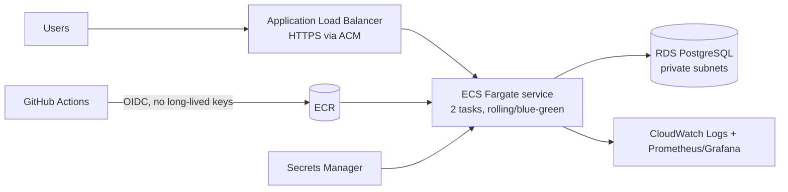

# Cost-aware path to AWS (design only — nothing is deployed)

## Target architecture (ECS on Fargate)

## Phased, cost-aware plan
| Phase | Setup | Approx. monthly cost* | Why |
|---|---|---|---|
| 0 (now) | Docker Compose on a laptop | $0 | assessment scope |
| 1 | One small EC2 / Lightsail instance running the same Compose file | ~$5–15 | cheapest real hosting |
| 2 | ECS Fargate (0.25 vCPU / 0.5 GB × 2) + ALB + RDS `db.t4g.micro` single-AZ | ~$60–90 | managed, no servers to patch |
| 3 | Multi-AZ RDS, autoscaling, WAF | higher, only when traffic/SLA needs it | production hardening |

\*Rough order-of-magnitude estimates; check the AWS pricing calculator before committing.

## Cost controls
AWS Budgets alerts, resource tagging, ECR lifecycle policy (keep last 10 images), schedule non-prod to scale to zero off-hours, log retention 14–30 days, Graviton (ARM) tasks, Savings Plans only after usage is stable.

## Why ECS before EKS
EKS adds a control-plane fee and Kubernetes operational overhead. For one small service, ECS Fargate is simpler and cheaper; move to EKS only if the team already runs Kubernetes or needs its ecosystem.

## Security on AWS
Tasks in private subnets, least-privilege task roles, secrets from Secrets Manager (never env files), GitHub→AWS via OIDC role, ECR image scanning on push, security groups allowing only ALB→tasks→RDS.
